# Session 31 — The Red Trail · flow chart

> **Carried from Session 30 at its `/recap` (2026-10-21), reworked the same day.** The played
> nodes are dropped; the played chart stays in `historian/sessions/Session 30 Keep the Ale/_flow.md`.
> Two draft beats were added: `S2_DIP` and `S2_CRYSTALS`.

Not an entity. A derived view of `Session 30 Keep the Ale.md` in this folder, drawn for reading at
the table. The `_` prefix keeps it out of `validate.ps1`'s entity checks and the semantic index.

The pursuit half grows out of the workshop's `act-1-flow/02-session-2-pursuit.md`; this file is the
graduated copy and is now the one to edit. Ids use `S2_` (act session 2).

Legend: rust is combat · parchment is social · lantern-yellow diamond is a real fork · green is a
share tick or payoff · blue is a thread planted · dashed dusty red is a designed setback · dashed
grey is undecided. Markers: `[x]` committed, `[-]` draft, `[?]` open. Boxes are the scenes.

**Commitment:** every node is `[x]` except the two 2026-10-21 drafts, `S2_DIP` and `S2_CRYSTALS` (`[-]`). Beats carried from Session 29 were committed by Jeff
2026-10-05; his choices of 2026-10-07 (Spear at the ford, the tally drop, the camp's three
discoverables, the cart and horses, the silhouette in the cell, the chase scoring, the three
level-ups, `S2_HEARTH`); the rest, including the engine's 2026-10-09 choice proposals, were
committed by Jeff 2026-10-13 after the `/review` pass. See the ledger below.

**Difficulty, as settled:** standard attrition, standard lethality. No long rest before the camp
(24-hour rule held); one short rest at dawn. Nella spreads her fire to wound and pin. Iggy, Odibli and Halsby all level before the camp, so the camp is sized Hard against an all-5 party with a mixed crew (drover, two cask-hands, a sneak, a healer, a roof crossbow, two dogs); the fork stays under Easy as an objective fight.

```mermaid
flowchart TD
  subgraph SC3["Scene 1 · The Rest of the Night"]
    S2_DIP["[-] S2_DIP<br/>Dip's owed moment<br/>The private roll from the song, as a flashback<br/>The 150 gp: keep it, or toward Sable's debt"]
    S2_BOON["[x] S2_BOON<br/>Odibli's stone does nothing at all<br/>The deed, still unsigned, still on the table"]
    S2_HEARTH["[x] S2_HEARTH<br/>The hearth is dying: Tallis's smother-charm<br/>The party feeds the flame; Odibli writes over the glyph<br/>Odibli levels to 5 · they sleep, not a long rest"]
    S2_DIP --> S2_BOON --> S2_HEARTH
  end

  subgraph SC4["Scene 2 · Dawn at the Ford"]
    S2_SHORT_REST["[x] S2_SHORT_REST<br/>One short rest before they ride"]
    S2_HORSES["[x] S2_HORSES<br/>Silas lends the horses<br/>'Bring them back shod' — a favour debt"]
    S2_SPEAR["[x] S2_SPEAR<br/>The fox waits on a dry stone mid-ford<br/>Two minutes: spear and shard fused<br/>The Shadowless Spear — Halsby's beat<br/>Halsby levels to 5"]
    S2_TRAIL["[x] S2_TRAIL<br/>Deep ruts, a split stave, southeast"]
    S2_SHORT_REST --> S2_HORSES --> S2_SPEAR --> S2_TRAIL
  end

  subgraph SC5["Scene 3 · The Red Trail — the chase"]
    S2_CHASE_RULES["[x] S2_CHASE_RULES<br/>Four stages, one check per PC per stage<br/>A stage is won when half the party passes<br/>Failures cost lead, never the trail"]
    S2_FORD_STAGE["[x] S2_FORD_STAGE<br/>Stage 1 · the far bank · DC 12"]
    S2_ROAD{"[x] S2_ROAD<br/>Stage 2 · the drover's road<br/>Road DC 13, a loss costs time<br/>Shortcut DC 11, a loss lames a horse<br/>A cracked shoe, a weeping cask, antler shavings"}
    S2_FORK["[x] S2_FORK<br/>Stage 3 · the dusk fork · DC 13<br/>A false trail laid with a dragged log"]
    S2_APPROACH{"[x] S2_APPROACH<br/>Stage 4 · the camp approach<br/>Ride in DC 14 · on foot DC 12, horses left behind<br/>Stages won set the camp:<br/>4 unaware · 2–3 dusk · 0–1 night alert"}
    S2_CHASE_RULES --> S2_FORD_STAGE --> S2_ROAD --> S2_FORK
  end

  subgraph SC6["Scene 4 · The Dusk Fork — the rear guard"]
    S2_REARGUARD["[x] S2_REARGUARD<br/>Ilsa, Fennel and the wolf Cinder<br/>Won stage 3: the party sees them first<br/>They go for the horses"]
    S2_RIDER{"[x] S2_RIDER<br/>Does a rider reach the camp?<br/>Only Ilsa carries it: alert up one step<br/>after stage 4, capped at night alert"}
    S2_REARGUARD --> S2_RIDER
  end

  subgraph SC7["Scene 5 · The Waystation"]
    S2_SCOUT["[x] S2_SCOUT<br/>Scout first: the blind, the rigged bridge,<br/>a horse tied half a mile out<br/>'Someone's planned a way out of here'"]
    S2_APPROACH_CHOICE{"[x] S2_APPROACH_CHOICE<br/>Heist, assault, parley or trick?"}
    S2_HEIST["[x] S2_HEIST<br/>Night heist: the cart out, no fight<br/>The party leaves her the taunt<br/>Tally rides away under the seat; no escape ladder"]
    S2_PARLEY["[x] S2_PARLEY<br/>Parley under a truce-branch<br/>She keeps the casks; her debt shows its edge"]
    S2_CRYSTALS["[-] S2_CRYSTALS<br/>The crew wear crystals too<br/>A broadcast to all is heard in the camp<br/>A heist goes loud, or Nella shoots first"]
    S2_FIGHT["[x] S2_FIGHT<br/>The floor: Varrick, 2 cask-hands, a sneak, a healer, a roof crossbow, 2 dogs<br/>The ridge: Nella, wound and pin<br/>Hard vs. an all-5 party · 3–4 rounds"]
    S2_MORALE["[x] S2_MORALE<br/>Drover down or the crew down to two<br/>DC 12 WIS; the rest break"]
    S2_ESCAPE["[x] S2_ESCAPE<br/>Nella loses, and gets away<br/>Covering fire · 'Keep the ale.' · bridge dropped · cached horse"]
    S2_TALLY["[x] S2_TALLY<br/>She drops her debt tally<br/>Notched antler and a counted purse"]
    S2_CAMP_INTEL["[x] S2_CAMP_INTEL<br/>The band's size · Harrow Bane in the ledger<br/>The Marlow aegis-banner, theirs to take<br/>Varrick's Parrying Bracer, for Dip"]
    S2_APPROACH_CHOICE -->|"sneak"| S2_HEIST
    S2_APPROACH_CHOICE -->|"talk"| S2_PARLEY
    S2_APPROACH_CHOICE -->|"attack or trick"| S2_FIGHT
    S2_HEIST -->|"it goes loud"| S2_FIGHT
    S2_HEIST -.->|"someone broadcasts"| S2_CRYSTALS
    S2_CRYSTALS -.->|"loud"| S2_FIGHT
    S2_PARLEY -->|"talk fails"| S2_FIGHT
    S2_FIGHT --> S2_MORALE --> S2_ESCAPE --> S2_TALLY
    S2_SCOUT -.->|"exit cut: skip those rungs"| S2_ESCAPE
    S2_HEIST -->|"clean: tally under the cart seat"| S2_TALLY
    S2_TALLY --> S2_CAMP_INTEL
  end

  subgraph SC8["Scene 6 · The Man in the Cell"]
    S2_HAUL_HOME["[x] S2_HAUL_HOME<br/>The casks come home on their own cart<br/>The horses go back to Silas<br/>The second deed, banked"]
    S2_CELL["[x] S2_CELL<br/>A raider walked in and surrendered<br/>A silhouette behind Mara's bars<br/>The town wants a rope"]
    S2_HAUL_HOME --> S2_CELL
  end

  S2_SKIP["[x] S2_SKIP<br/>They skip the pursuit<br/>The cart reaches a Duskwater fence<br/>The casks cost more later"]

  S2_HEARTH --> S2_SHORT_REST
  S2_TRAIL --> S2_CHASE_RULES
  S2_FORK --> S2_REARGUARD
  S2_RIDER --> S2_APPROACH
  S2_APPROACH --> S2_APPROACH_CHOICE
  S2_APPROACH -.->|"they scout"| S2_SCOUT
  S2_SCOUT --> S2_APPROACH_CHOICE
  S2_CAMP_INTEL --> S2_HAUL_HOME
  S2_BOON -.->|"they stay to build"| S2_SKIP

  classDef combat fill:#F6DCD3,stroke:#B4452A,color:#5A1E10
  classDef social fill:#E6E3D5,stroke:#8C8463,color:#3D3A28
  classDef decision fill:#FDF0CE,stroke:#C79A2B,color:#5A4410
  classDef stake fill:#D9E8DC,stroke:#4F8060,color:#1F3D2A
  classDef seed fill:#DCE3EF,stroke:#5E7296,color:#24334D
  classDef open fill:#EDEAE6,stroke:#9A948C,color:#4A453F,stroke-dasharray:4 3
  classDef fail fill:#EFE2E2,stroke:#A3736E,color:#4A2C29,stroke-dasharray:4 3

  class S2_REARGUARD,S2_FIGHT,S2_MORALE,S2_ESCAPE combat
  class S2_DIP,S2_HORSES,S2_PARLEY,S2_HEIST,S2_SHORT_REST,S2_CHASE_RULES,S2_FORD_STAGE,S2_FORK,S2_TRAIL social
  class S2_APPROACH,S2_RIDER,S2_APPROACH_CHOICE,S2_ROAD decision
  class S2_CRYSTALS,S2_HEARTH,S2_SPEAR,S2_HAUL_HOME stake
  class S2_BOON,S2_TALLY,S2_CAMP_INTEL,S2_CELL,S2_SCOUT seed
  class S2_SKIP fail
```

## Commitment ledger

Played at Session 30 and dropped here: `S2_SABLE_FREE`, `S2_LOOT`, `S2_TOWN`, `S2_NAMES`,
`S2_WREN`, `S2_OFFER`, `S2_IGGY`, `S2_COMPANIONS`. Cut by Jeff 2026-10-27 (it didn't do much):
`S2_STATEMENT`. Not yet committed: `S2_DIP`, `S2_CRYSTALS`.

- `S2_BOON` — backing note at the plan, `S2_BOON`; approved 2026-10-05
- `S2_HEARTH` — backing note at the plan, `S2_HEARTH`; approved 2026-10-07
- `S2_SHORT_REST` — backing note at the plan, `S2_SHORT_REST`; approved 2026-10-07
- `S2_HORSES` — backing note at the plan, `S2_HORSES`; approved 2026-10-07
- `S2_SPEAR` — backing note at the plan, `S2_SPEAR`; approved 2026-10-07
- `S2_CHASE_RULES` — backing note at the plan, `S2_CHASE_RULES`; approved 2026-10-07
- `S2_ESCAPE` — backing note at the plan, `S2_ESCAPE`; approved 2026-10-07
- `S2_TALLY` — backing note at the plan, `S2_TALLY`; approved 2026-10-07
- `S2_CAMP_INTEL` — backing note at the plan, `S2_CAMP_INTEL`; approved 2026-10-07
- `S2_HAUL_HOME` — backing note at the plan, `S2_HAUL_HOME`; approved 2026-10-07
- `S2_CELL` — backing note at the plan, `S2_CELL`; approved 2026-10-07
- `S2_TRAIL` — backing note at the plan, `S2_TRAIL`; approved 2026-10-13
- `S2_FORD_STAGE` — backing note at the plan, `S2_FORD_STAGE`; approved 2026-10-13
- `S2_ROAD` — backing note at the plan, `S2_ROAD`; approved 2026-10-13
- `S2_FORK` — backing note at the plan, `S2_FORK`; approved 2026-10-13
- `S2_APPROACH` — backing note at the plan, `S2_APPROACH`; approved 2026-10-13
- `S2_REARGUARD` — backing note at the plan, `S2_REARGUARD`, plus Combatants and `maps/`; approved 2026-10-13
- `S2_RIDER` — backing note at the plan, `S2_RIDER`, plus Combatants and `maps/`; approved 2026-10-13
- `S2_SCOUT` — backing note at the plan, `S2_APPROACH_CHOICE` (scout bullet) and `S2_ESCAPE`; approved 2026-10-13
- `S2_APPROACH_CHOICE` — backing note at the plan, `S2_APPROACH_CHOICE`; approved 2026-10-13
- `S2_HEIST` — backing note at the plan, `S2_APPROACH_CHOICE`; approved 2026-10-13
- `S2_PARLEY` — backing note at the plan, `S2_APPROACH_CHOICE`; approved 2026-10-13
- `S2_FIGHT` — backing note at the plan, `S2_FIGHT`, plus Combatants and `maps/`; approved 2026-10-13
- `S2_MORALE` — backing note at the plan, `S2_MORALE`; approved 2026-10-13
- `S2_SKIP` — backing note at the plan, `S2_SKIP`; approved 2026-10-13
