> **Reworked for daylight (2026-11-04), trimmed the same day.** Session 32 played Scenes 1 and 2 and
> the scout; those nodes are dropped, and the played chart stays in
> `historian/sessions/Session 32 The Red Trail/_flow.md`. The party arrived at 10 a.m., so the camp
> fight is redrawn for daylight under low cloud: the camp digs in and lays an ambush on its crystal
> warning, Ilsa and Cinder fight, and Halsby spots it go in. Three new nodes open Scene 3
> (`S2_TEN_MINUTES`, `S2_SPOTTER`, `S2_AMBUSH`). Cut: `S2_HEIST` (no night heist against a warned
> camp) and `S2_SKIP` (the party is already there).

> **Earlier carries:** from Session 31 (2026-10-27) and Session 30 (2026-10-21). Their played charts
> stay in their historian folders.

Not an entity. A derived view of `Session 33 The Red Trail.md` in this folder, drawn for reading at
the table. The `_` prefix keeps it out of `validate.ps1`'s entity checks and the semantic index.

The pursuit half grows out of the workshop's `act-1-flow/02-session-2-pursuit.md`; this file is the
graduated copy and is now the one to edit. Ids use `S2_` (act session 2).

Legend: rust is combat · parchment is social · lantern-yellow diamond is a real fork · green is a
share tick or payoff · blue is a thread planted · dashed dusty red is a designed setback · dashed
grey is undecided. Markers: `[x]` committed, `[-]` draft, `[?]` open. Boxes are the scenes.

**Commitment:** every node is `[x]`. Jeff approved all fourteen after the daylight rework,
2026-11-04. See the ledger below.

**Difficulty, as settled:** standard attrition, standard lethality. The party is nearly fresh.
The camp is 2,225 XP, ~5,563 adjusted, just over Deadly on paper. It plays about Hard if the
party knows where the ambush is, and Deadly if they walk into it. Nella fights out of low cloud,
reachable only by readied actions, until Iggy's wings light it.

```mermaid
flowchart TD
  subgraph SC3["Scene 3 · The Waystation"]
    S2_TEN_MINUTES{"[x] S2_TEN_MINUTES<br/>The hill: ten minutes, a hungry horse<br/>Go now: ambush half built<br/>Use the time: Halsby's report, set up"}
    S2_SPOTTER{"[x] S2_SPOTTER<br/>Halsby watches the ambush go in<br/>Broadcast · walk back · stay at the bridge"}
    S2_AMBUSH["[x] S2_AMBUSH<br/>The cart turned broadside, stakes on the open ground<br/>Ilsa and Cinder in the south tree line<br/>Sennet at the side door · Nella in the cloud"]
    S2_APPROACH_CHOICE{"[x] S2_APPROACH_CHOICE<br/>Assault, parley, trick,<br/>or spring the ambush on purpose?"}
    S2_PARLEY["[x] S2_PARLEY<br/>Parley under a truce-branch<br/>She keeps the casks; her debt shows its edge"]
    S2_CRYSTALS["[x] S2_CRYSTALS<br/>The crew wear crystals too<br/>Varrick banned talking into them<br/>They still hear the party: lies, panic, one slip"]
    S2_FIGHT["[x] S2_FIGHT<br/>The floor: Varrick, 2 cask-hands, a sneak, a healer,<br/>a roof crossbow, Ilsa and Cinder<br/>The cloud: Nella on Tithe, out, two arrows, back in<br/>~5,563 adjusted · 3–4 rounds"]
    S2_IGGY_BEAT{"[x] S2_IGGY_BEAT<br/>'Up, Wallaed': Iggy's wings open<br/>Sah speaks through every crystal; the cloud lights<br/>The griffon shies into range<br/>Iggy: chase Nella or turn back"}
    S2_MORALE["[x] S2_MORALE<br/>Drover down or the crew down to two<br/>DC 12 WIS; the rest break, Ilsa and Cinder too"]
    S2_ESCAPE["[x] S2_ESCAPE<br/>Nella loses, and gets away<br/>Covering fire · 'Keep the ale.' · east through the cloud<br/>On foot: the bridge, then the river"]
    S2_TALLY["[x] S2_TALLY<br/>She drops her debt tally<br/>Notched antler and a counted purse"]
    S2_CAMP_INTEL["[x] S2_CAMP_INTEL<br/>The band's size · Harrow Bane in the ledger<br/>The Marlow aegis-banner, theirs to take<br/>Varrick's Parrying Bracer, for Dip"]
    S2_TEN_MINUTES -->|"use the time"| S2_SPOTTER
    S2_SPOTTER --> S2_AMBUSH
    S2_TEN_MINUTES -.->|"go now: half built"| S2_AMBUSH
    S2_SPOTTER -.->|"broadcast: one piece moves"| S2_CRYSTALS
    S2_AMBUSH --> S2_APPROACH_CHOICE
    S2_APPROACH_CHOICE -->|"talk"| S2_PARLEY
    S2_APPROACH_CHOICE -->|"attack, trick or bait"| S2_FIGHT
    S2_PARLEY -->|"talk fails"| S2_FIGHT
    S2_CRYSTALS -.->|"lies or a slip"| S2_FIGHT
    S2_FIGHT --> S2_MORALE --> S2_ESCAPE --> S2_TALLY
    S2_FIGHT --> S2_IGGY_BEAT
    S2_IGGY_BEAT -->|"she breaks"| S2_ESCAPE
    S2_IGGY_BEAT -.->|"chase: tally in hand"| S2_TALLY
    S2_SPOTTER -.->|"stayed: on her way out"| S2_ESCAPE
    S2_TALLY --> S2_CAMP_INTEL
  end

  subgraph SC4["Scene 4 · The Man in the Cell"]
    S2_HAUL_HOME["[x] S2_HAUL_HOME<br/>The casks come home on their own cart<br/>The horses go back to Silas<br/>The second deed, banked"]
    S2_CELL["[x] S2_CELL<br/>A raider walked in and surrendered<br/>A silhouette behind Mara's bars<br/>The town wants a rope"]
    S2_HAUL_HOME --> S2_CELL
  end

  S2_CAMP_INTEL --> S2_HAUL_HOME

  classDef combat fill:#F6DCD3,stroke:#B4452A,color:#5A1E10
  classDef social fill:#E6E3D5,stroke:#8C8463,color:#3D3A28
  classDef decision fill:#FDF0CE,stroke:#C79A2B,color:#5A4410
  classDef stake fill:#D9E8DC,stroke:#4F8060,color:#1F3D2A
  classDef seed fill:#DCE3EF,stroke:#5E7296,color:#24334D
  classDef open fill:#EDEAE6,stroke:#9A948C,color:#4A453F,stroke-dasharray:4 3
  classDef fail fill:#EFE2E2,stroke:#A3736E,color:#4A2C29,stroke-dasharray:4 3

  class S2_FIGHT,S2_MORALE,S2_ESCAPE combat
  class S2_PARLEY social
  class S2_TEN_MINUTES,S2_SPOTTER,S2_APPROACH_CHOICE,S2_IGGY_BEAT decision
  class S2_AMBUSH,S2_HAUL_HOME stake
  class S2_CRYSTALS,S2_TALLY,S2_CAMP_INTEL,S2_CELL seed
```

## Commitment ledger

Played at Sessions 30–32 and dropped here (see each session's historian `_flow.md`). Cut:
`S2_STATEMENT` (2026-10-27), `S2_HEIST` and `S2_SKIP` (daylight rework, 2026-11-04). Everything
was re-approved after the daylight rework; earlier approvals (2026-10-07, 2026-10-13, 2026-10-28)
are superseded.

- `S2_TEN_MINUTES` — backing note at the plan, `S2_TEN_MINUTES`; approved 2026-11-04
- `S2_SPOTTER` — backing note at the plan, `S2_SPOTTER`; approved 2026-11-04
- `S2_AMBUSH` — backing note at the plan, `S2_AMBUSH`, plus `maps/waystation.txt`; approved 2026-11-04
- `S2_APPROACH_CHOICE` — backing note at the plan, `S2_APPROACH_CHOICE`; approved 2026-11-04
- `S2_PARLEY` — backing note at the plan, `S2_APPROACH_CHOICE`; approved 2026-11-04
- `S2_CRYSTALS` — backing note at the plan, `S2_CRYSTALS`; approved 2026-11-04
- `S2_FIGHT` — backing note at the plan, `S2_FIGHT`, plus Combatants and `maps/`; approved 2026-11-04
- `S2_IGGY_BEAT` — backing note at the plan, `S2_IGGY_BEAT`; approved 2026-11-04
- `S2_MORALE` — backing note at the plan, `S2_MORALE`; approved 2026-11-04
- `S2_ESCAPE` — backing note at the plan, `S2_ESCAPE`; approved 2026-11-04
- `S2_TALLY` — backing note at the plan, `S2_TALLY`; approved 2026-11-04
- `S2_CAMP_INTEL` — backing note at the plan, `S2_CAMP_INTEL`; approved 2026-11-04
- `S2_HAUL_HOME` — backing note at the plan, `S2_HAUL_HOME`; approved 2026-11-04
- `S2_CELL` — backing note at the plan, `S2_CELL`; approved 2026-11-04
