# Session 29 — The Mistake · flow chart

Not an entity. A derived view of `Session 29 The Mistake.md` in this folder, drawn for reading at
the table. The `_` prefix keeps it out of `validate.ps1`'s entity checks and the semantic index.

**Upstream source:** `workshop/first-homebrew-act/notes/act-1-flow/01-session-1-raid.md`, which is
part of the act's full flow graph set (act spine plus one graph per session) and is where
`scripts/flow-status.py` reads commitment coverage. That set is gitignored workshop scratch; this
file is the graduated snapshot that travels with the session. **If you change one, change both** —
or regenerate this one with `/flow --session 29`.

Legend: rust is combat · parchment is social · lantern-yellow diamond is a real fork · green is a
share tick or payoff · blue is a thread planted · dashed dusty red is a designed setback · dashed
grey is undecided. Markers: `[x]` committed, `[-]` draft, `[?]` open. Boxes are the five scenes.

**Tuesday 2026-10-06.** This is **Session 29** in the campaign's continuous numbering — "Session 1"
is act-relative shorthand only. The written plan is
`Session 29 The Mistake.md`, beside this file, and this graph maps it.

**Difficulty, as settled:** light attrition, standard lethality. The act's curve calls this slot
5 of 10 standard/standard, but the raid's own design says no PC dies in the premiere, so the
session plan settled it one notch softer. The session plan wins.

Rulings baked in: the transit through the Boon **counts as a long rest**, told in fiction as the
party teleports; the party **stays at level 4**; the roster is **5 bandits plus one big one**,
which is the statblock's documented assumption for 5 PCs at level 4, Halsby included.

The five boxes are the five scenes of the written plan, in order.

```mermaid
flowchart TD
  subgraph SC1["Scene 1 · The Last Thirty Seconds"]
    S1_REPLAY["[-] S1_REPLAY<br/>Replay the last thirty seconds of Session 28<br/>Hands joined, Odibli's hand on the stone,<br/>the light climbing past blinding"]
    S1_REST["[-] S1_REST<br/>The long rest happens here, inside the transit<br/>Full HP, every slot, hit dice back, afflictions go quiet<br/>Tell them in fiction — never announce it as a rules call"]
    S1_REPLAY --> S1_REST
  end

  subgraph SC2["Scene 2 · Somewhere You Can Gather Strength"]
    S1_STANCE{"[-] S1_STANCE<br/>Each player picks how their character lands:<br/>steady themselves, or read the yard?<br/>One roll each at DC 12, then initiative"}
    S1_STEADY["[-] S1_STEADY<br/>Steady — try to land square on your feet<br/>CON, Athletics or Acrobatics<br/>Fail and you spend round 1 arriving badly"]
    S1_READ["[-] S1_READ<br/>Read — take in the yard while still falling into it<br/>WIS, INT or Perception<br/>Succeed for an initiative edge, or one raider caught flat-footed"]
    S1_SCATTER["[-] S1_SCATTER<br/>Nobody lands facing the same way, so the party starts split<br/>Some PCs out in the yard near the cask-runners,<br/>some by the doorway where Sable is<br/>This is a positioning puzzle, not a punishment"]
    S1_MIDRAID["[-] S1_MIDRAID<br/>The raid is already half finished when they arrive<br/>Nella and half her crew are long gone with most of the ale<br/>Wick's crew has already hit the far side of town and left"]
    S1_ENGAGE{"[-] S1_ENGAGE<br/>Does the party step in, or stand back and watch?<br/>The campaign's first real choice"}
    S1_STANCE --> S1_STEADY --> S1_SCATTER
    S1_STANCE --> S1_READ --> S1_SCATTER
    S1_SCATTER --> S1_MIDRAID --> S1_ENGAGE
  end

  subgraph SC3["Scene 3 · The New Wing — the fight"]
    S1_FIGHT["[-] S1_FIGHT<br/>The fight in the half-built brewery wing<br/>5 bandits plus one big unnamed leader, 3 to 5 rounds<br/>Leaderless fodder — Nella is not here<br/>KEEP EACH RAIDER ON ITS JOB: all six piling onto one PC<br/>is about 30 damage a round, a full tier harder than planned"]
    S1_FORK{"[-] S1_FORK<br/>The party cannot cover both ends of the yard<br/>Two bandits are walking the last cask to the cart<br/>and the big one is two rounds from dragging Sable off"}
    S1_CASKS["[-] S1_CASKS<br/>Go after the last cask<br/>Two bandits haul it about 15 ft a turn<br/>If it reaches the cart it is gone for good,<br/>and that loss is what feeds Session 2"]
    S1_SABLE["[-] S1_SABLE<br/>Go after Sable instead<br/>The big one has a fist in her coat at the bar<br/>Left alone about two rounds, he drags her out as leverage"]
    S1_OUTS{"[-] S1_OUTS<br/>Talking the raid down works too, and is encouraged<br/>Any of these can trigger the morale check early<br/>or hand the party advantage"}
    S1_PARLEY["[-] S1_PARLEY<br/>Parley — point out they came for goods, not for blood"]
    S1_SCARE["[-] S1_SCARE<br/>Intimidate — you are five strangers who just stepped<br/>out of a pillar of light nobody can explain"]
    S1_TRICK["[-] S1_TRICK<br/>Bluff — claim to be Marlow's own men<br/>They will believe it, because Marlow really does pay them"]
    S1_MORALE["[-] S1_MORALE<br/>Put the big one down and the rest break<br/>Killed, frightened or talked down, either way<br/>survivors roll DC 12 WIS, and failures run<br/>dropping whatever they were carrying"]
    S1_DEED["[-] S1_DEED<br/>Objective met: Sable is safe and some stock is saved<br/>This is the favour Sable pays for in Scene 5<br/>with the 10 percent share"]
    S1_BOTCH["[-] S1_BOTCH<br/>Worst case, and it is still not a death<br/>The big one hauls Sable off and more stock walks<br/>Deeper setback plus a rescue hook<br/>No PC dies in the premiere"]
    S1_FIGHT --> S1_FORK
    S1_FORK -->|"chase the cask"| S1_CASKS
    S1_FORK -->|"save Sable"| S1_SABLE
    S1_FIGHT --> S1_OUTS
    S1_OUTS --> S1_PARLEY
    S1_OUTS --> S1_SCARE
    S1_OUTS --> S1_TRICK
    S1_OUTS --> S1_MORALE
    S1_CASKS --> S1_DEED
    S1_SABLE --> S1_DEED
    S1_PARLEY --> S1_DEED
    S1_SCARE --> S1_DEED
    S1_TRICK --> S1_DEED
    S1_MORALE --> S1_DEED
  end

  subgraph SC4["Scene 4 · What the Raid Left — the town"]
    S1_TOWN["[-] S1_TOWN<br/>After the fight, meet the town<br/>Sheriff Mara Tull wants to know what five armed<br/>strangers are, fast. Mayor Silas Crubb wants the<br/>ledger to balance. Cut to narration if the fight ran long"]
    S1_NAMES["[-] S1_NAMES<br/>Town talk plants three names and stops there<br/>Nella, plus a direction: southeast, laden cart, deep ruts<br/>Wick, described by witnesses but never seen<br/>Harrow Bane, a name the town fears with no face attached"]
    S1_TOWN --> S1_NAMES
  end

  subgraph SC5["Scene 5 · The Mistake — the offer"]
    S1_WREN["[-] S1_WREN<br/>Sable Wren is running the Golden Lioness entirely alone<br/>Her crew never arrived. The new wing is finished,<br/>empty, undefended, and was supposed to open"]
    S1_OFFER["[-] S1_OFFER<br/>The offer, and it is a deal rather than charity<br/>10 percent of the Lioness now, for tonight's deed<br/>Grows to 25 then 40 percent by deeds, never by coin<br/>One favour owed per time they help the town<br/>Building out a room runs 250 to 500 gp<br/>Have these numbers on a card so it lands concrete"]
    S1_ODIBLI["[-] S1_ODIBLI<br/>Odibli is handed a stake in a brewery<br/>Session 28's table notes say his plan to conquer Vallaki<br/>through the power of good wine got real buy-in<br/>Hand it straight to Miguel and do not explain the joke"]
    S1_IGGY["[-] S1_IGGY<br/>Iggy plays the room he just saved — his spotlight beat<br/>He is overdue, 2 rotation turns against everyone else's 4<br/>Seeds his open hook, the unfinished song trapped in the viol<br/>One or two lines only, and no resolution"]
    S1_LOOT["[?] S1_LOOT<br/>OPEN: which single Common item comes out of the raid<br/>The pick is the DM's, not the planner's<br/>Recommended: The Second String, a viol string from<br/>meta/loot-options/Iggy/misc<br/>Nobody levels tonight — say out loud that the next<br/>share tick is the trigger, which answers Ben's Session 28 push"]
    S1_BOON["[-] S1_BOON<br/>Close on the relic doing nothing at all<br/>Odibli takes the stone out and it is warm as a pocketed<br/>pebble and completely dead<br/>Without this beat the season reads as a detour<br/>instead of the errand the relic sent them on"]
    S1_WREN --> S1_OFFER --> S1_ODIBLI --> S1_IGGY --> S1_LOOT --> S1_BOON
  end

  S1_REST --> S1_STANCE
  S1_ENGAGE -->|"they step in"| S1_FIGHT
  S1_ENGAGE -->|"they hang back and let it happen"| S1_BOTCH
  S1_BOTCH -->|"the setback raises what the base-building is worth"| S1_DEED
  S1_DEED --> S1_TOWN
  S1_NAMES --> S1_WREN

  S1_NELLA["[-] S1_NELLA<br/>Nella is glimpsed fleeing at a distance<br/>DO NOT let the party catch her — the whole of Session 2<br/>is the chase after the cart she is taking southeast"]
  S1_BANNER["[?] S1_BANNER<br/>OPEN: the aegis-banner flying on the raiders' line<br/>topics/feud.md locks it as recoverable in this raid,<br/>then hanging in the Lioness as the prop that unspools the feud<br/>But the written session plan budgets exactly ONE feud detail<br/>tonight, the matched boots. Running both over-spends the feud<br/>Pick one, or hold the banner for Session 2"]
  S1_GUEST["[?] S1_GUEST<br/>OPEN: does a cameo guest play this session?<br/>A guest is the SIXTH body, and the body count is what<br/>pushes the fight past spec — add 1 to 2 bandits if so<br/>The party's level is not the problem"]

  S1_FIGHT -.-> S1_NELLA
  S1_NELLA -.-> S1_NAMES
  S1_FIGHT -.-> S1_BANNER
  S1_GUEST -.->|"if a guest sits in, retune here"| S1_FIGHT

  classDef combat fill:#F6DCD3,stroke:#B4452A,color:#5A1E10
  classDef social fill:#E6E3D5,stroke:#8C8463,color:#3D3A28
  classDef decision fill:#FDF0CE,stroke:#C79A2B,color:#5A4410
  classDef stake fill:#D9E8DC,stroke:#4F8060,color:#1F3D2A
  classDef seed fill:#DCE3EF,stroke:#5E7296,color:#24334D
  classDef open fill:#EDEAE6,stroke:#9A948C,color:#4A453F,stroke-dasharray:4 3
  classDef fail fill:#EFE2E2,stroke:#A3736E,color:#4A2C29,stroke-dasharray:4 3

  class S1_FIGHT,S1_CASKS,S1_SABLE,S1_MORALE combat
  class S1_REPLAY,S1_REST,S1_STEADY,S1_READ,S1_SCATTER,S1_MIDRAID,S1_PARLEY,S1_SCARE,S1_TRICK,S1_TOWN,S1_WREN social
  class S1_STANCE,S1_ENGAGE,S1_FORK,S1_OUTS decision
  class S1_DEED,S1_OFFER stake
  class S1_NELLA,S1_NAMES,S1_BOON,S1_ODIBLI,S1_IGGY seed
  class S1_GUEST,S1_LOOT,S1_BANNER open
  class S1_BOTCH fail
```

The two anchors are the fight in `S1_FIGHT` and the offer in `S1_OFFER`. Everything between them is
elastic: cut `S1_TOWN` to narration if the fight ran long, stretch it if it did not.

`S1_FORK` is the scene's whole design. The six raiders are kept on separate jobs — two on the cask,
one on Sable, three screening — and that split is the only thing holding the fight at standard
lethality. Let them all converge on one PC and the numbers quietly become dangerous.

All five non-combat routes out of `S1_OUTS` reach `S1_DEED`, so none of them costs the party the
foothold. `S1_SCARE` is the best use of the arrival: strangers who appeared out of a light nobody
can explain, working on leaderless mooks.

`S1_BOTCH` is the only node reachable by doing nothing, and it still routes to `S1_DEED` — failing
deepens the setback and makes the share worth more, it does not end the session's spine.

## Commitment ledger

Nothing committed yet. Every node in this file is `[-]` draft or `[?]` open — see the commit gate
in `meta/flow-graphs.md`. Entries land here as the DM approves beats one at a time.
