# Session 29 — The Mistake · flow chart

Not an entity. A derived view of `Session 29 The Mistake.md` in this folder, drawn for reading at
the table. The `_` prefix keeps it out of `validate.ps1`'s entity checks and the semantic index.

**This file is the only copy.** The workshop's session-1 graph was deleted on 2026-10-04, so there
is no upstream to keep in sync. Every beat was walked and committed by Jeff on 2026-10-05.
`scripts/flow-status.py --set` reads this folder directly.

Legend: rust is combat · parchment is social · lantern-yellow diamond is a real fork · green is a
share tick or payoff · blue is a thread planted · dashed dusty red is a designed setback · dashed
grey is undecided. Markers: `[x]` committed, `[-]` draft, `[?]` open. Boxes are the scenes.

**Tuesday 2026-10-06.** This is **Session 29** in the campaign's continuous numbering — "Session 1"
is act-relative shorthand only. The written plan is
`Session 29 The Mistake.md`, beside this file, and this graph maps it.

**Difficulty, as settled:** light attrition, standard lethality. The act's curve calls this slot
5 of 10 standard/standard, but the raid's own design says no PC dies in the premiere, so the
session plan settled it one notch softer. The session plan wins.

Rulings baked in: the transit through the Boon **counts as a long rest**, told in fiction as the
party teleports; the party **stays at level 4**; the roster is **six bodies** (four bandits split
melee and crossbow, one hedge-mage, and the big one), sized for 5 PCs at level 4, Halsby included.

The boxes are the scenes of the written plan, in order. Scene 1b, Halsby's intro, starts on its
own with no arrow into it. It runs alongside the transit, not after it, and joins the spine at
the fight.

```mermaid
flowchart TD
  subgraph SC1["Scene 1 · The Last Thirty Seconds"]
    S1_REPLAY["[x] S1_REPLAY<br/>Replay the last thirty seconds of Session 28<br/>Hands joined, Odibli's hand on the stone,<br/>the light climbing past blinding"]
    S1_REST["[x] S1_REST<br/>The long rest happens here, inside the transit<br/>Full HP, every slot, hit dice back, afflictions go quiet<br/>Tell them in fiction — never announce it as a rules call"]
    S1_REPLAY --> S1_REST
  end

  subgraph S1_HALSBY["Scene 1b · The Green Eyes — Halsby's intro"]
    S1_WOODS["[x] S1_WOODS<br/>Halsby on the road to Tassad, on the Nightveil's errand<br/>An animal Kellan picks stops him on the path<br/>Green eyes leaking smoke, a voice inside his head<br/>Asher is riding it, and does not give his name"]
    S1_ASK["[x] S1_ASK<br/>The ask: save Sable at the brewery in Ashford, now<br/>and later help her with one more thing<br/>The offer: protection from the fade, as the Shadowless Spear<br/>Halsby keeps his spear and shard the whole time"]
    S1_SNAKE{"[x] S1_SNAKE<br/>Does he spot the snake hidden nearby?<br/>Within 10 ft his blindsight finds it<br/>Otherwise Stealth 14 against passive Perception 11"}
    S1_HAGGLE["[x] S1_HAGGLE<br/>He calls out the threat and bargains<br/>Persuasion or Intimidation DC 13<br/>Success: the spear comes in 1 to 2 sessions, not 3 to 4"]
    S1_ANSWER{"[x] S1_ANSWER<br/>Does he take the deal?"}
    S1_BITE["[x] S1_BITE<br/>He refuses, and the snake bites<br/>Poisoned until he drinks the antidote<br/>No damage, no death. The deal now adds the antidote"]
    S1_DEAL["[x] S1_DEAL<br/>The deal stands: save Sable now, help her later<br/>Asher could fuse the spear in two minutes<br/>He waits because the spear is his leverage"]
    S1_WOODS --> S1_ASK --> S1_SNAKE
    S1_SNAKE -->|"he spots it"| S1_HAGGLE --> S1_ANSWER
    S1_SNAKE -->|"he misses it"| S1_ANSWER
    S1_ANSWER -->|"yes"| S1_DEAL
    S1_ANSWER -->|"no"| S1_BITE --> S1_DEAL
  end

  subgraph SC2["Scene 2 · Somewhere You Can Gather Strength"]
    S1_STANCE{"[x] S1_STANCE<br/>Each player picks how their character lands:<br/>steady themselves, or read the yard?<br/>One roll each at DC 12, then initiative"}
    S1_STEADY["[x] S1_STEADY<br/>Steady — try to land square on your feet<br/>CON, Athletics or Acrobatics, and the roll sets where they land<br/>17+: pick your spot · 12–16: about 30 ft from the bandits<br/>11 or less: prone, in the middle of the bandits — no lost turn"]
    S1_READ["[x] S1_READ<br/>Read — take in the yard while still falling into it<br/>WIS, INT or Perception<br/>Succeed for an initiative edge, or one raider caught flat-footed"]
    S1_SCATTER["[x] S1_SCATTER<br/>Nobody lands facing the same way, so the party starts split<br/>Places the Read PCs only — Steady's roll placed the rest<br/>Some PCs out in the yard near the cask-runners,<br/>some by the doorway where Sable is<br/>This is a positioning puzzle, not a punishment"]
    S1_MIDRAID["[x] S1_MIDRAID<br/>The raid is already half finished when they arrive<br/>Nella and half her crew are long gone with most of the ale<br/>Wick's crew has already hit the far side of town and left"]
    S1_ENGAGE{"[x] S1_ENGAGE<br/>Does the party step in, or stand back and watch?<br/>The campaign's first real choice<br/>Raiders jeer at anyone who landed among them:<br/>more pitiful villagers, cowards who should run"}
    S1_STANCE --> S1_STEADY --> S1_SCATTER
    S1_STANCE --> S1_READ --> S1_SCATTER
    S1_SCATTER --> S1_MIDRAID --> S1_ENGAGE
  end

  subgraph SC3["Scene 3 · The New Wing — the fight"]
    S1_FIGHT["[x] S1_FIGHT<br/>The fight in the half-built brewery wing, 3 to 5 rounds<br/>2 melee cask-haulers, 1 melee screen, 1 crossbow,<br/>1 hedge-mage, plus the big one on Sable<br/>Leaderless fodder — Nella is not here<br/>KEEP EACH RAIDER ON ITS JOB: all six piling onto one PC<br/>is about 30 damage a round, a full tier harder than planned"]
    S1_FORK{"[x] S1_FORK<br/>Pressure, not a lock: they may split and try both<br/>Two bandits are walking the last cask to the cart<br/>and the big one is two rounds from dragging Sable off"}
    S1_CASKS["[x] S1_CASKS<br/>Go after the last cask<br/>Two bandits haul it about 15 ft a turn<br/>If it reaches the cart it is gone for good,<br/>raising Session 2's stakes. Saved, it is a clean win"]
    S1_SABLE["[x] S1_SABLE<br/>Go after Sable instead<br/>She is bound and gagged: a fire explosive drew her out,<br/>a scroll of hold person took her. They feared a warlock<br/>The big one drags her to the back door, about two rounds<br/>Cutting her free is an action; freed, she fights"]
    S1_OUTS{"[x] S1_OUTS<br/>Talking the raid down works too, and is encouraged<br/>Any of these can trigger the morale check early<br/>or hand the party advantage"}
    S1_PARLEY["[x] S1_PARLEY<br/>Parley — point out they came for goods, not for blood<br/>12+: the surface line, it's the ale. 15+: one clue, 20+: two<br/>Clues hint the raids keep Ashford down, never who or why"]
    S1_SCARE["[x] S1_SCARE<br/>Intimidate — live from the first jeer, even before initiative<br/>DC 13 triggers morale early. Advantage with proof:<br/>a raider dropped, a spell, or the light only the big one saw"]
    S1_TRICK["[x] S1_TRICK<br/>Bluff — 'the boss sent us, change of plan'<br/>The party doesn't know Marlow, so the bluff stays generic<br/>DC 13: a round of hesitation or morale advantage<br/>18+: a raider slips 'Nella sent you?' — never Marlow"]
    S1_MORALE["[x] S1_MORALE<br/>Put the big one down and the rest break<br/>Killed, frightened or talked down, either way<br/>survivors roll DC 12 WIS, and failures run<br/>dropping whatever they were carrying"]
    S1_DEED["[x] S1_DEED<br/>Objective met: Sable is safe and some stock is saved<br/>This is the favour Sable pays for in Scene 5<br/>with the 10 percent share"]
    S1_BOTCH["[x] S1_BOTCH<br/>Worst case, and it is still not a death<br/>The big one hauls Sable off, still bound, and more stock walks<br/>Deeper setback plus a rescue hook<br/>No PC dies in the premiere"]
    S1_LOOT["[x] S1_LOOT<br/>Right after the fight, in the yard, before the town arrives<br/>The Earshot Crystals, one per PC, taken off the raiders<br/>Touch to speak, words only, to one holder you can see<br/>or to all holders within 300 ft. Confirmed by Jeff<br/>The raiders wore them and never used them, so they are a mystery<br/>Never say the twist: Nella and a few of her crew kept theirs<br/>Nobody levels tonight. Say levels are coming, one PC at a time"]
    S1_FIGHT --> S1_FORK
    S1_FORK -->|"chase the cask"| S1_CASKS
    S1_FORK -->|"save Sable"| S1_SABLE
    S1_FIGHT --> S1_OUTS
    S1_OUTS --> S1_PARLEY
    S1_OUTS --> S1_SCARE
    S1_OUTS --> S1_TRICK
    S1_OUTS --> S1_MORALE
    S1_CASKS --> S1_DEED
    S1_SABLE --> S1_DEED
    S1_PARLEY --> S1_DEED
    S1_SCARE --> S1_DEED
    S1_TRICK --> S1_DEED
    S1_MORALE --> S1_DEED
  end

  subgraph SC4["Scene 4 · What the Raid Left — the town"]
    S1_TOWN["[x] S1_TOWN<br/>The whole town was hit at once by separate groups<br/>Mara and Silas arrive late, bloodied from their own fights<br/>— why nobody came for Sable. Five strangers held the one<br/>place the town couldn't reach. Cut to narration if long"]
    S1_NAMES["[x] S1_NAMES<br/>Town talk plants three names and stops there<br/>Nella, plus a direction: southeast, laden cart, deep ruts<br/>Wick, described by witnesses but never seen<br/>Harrow Bane, a name the town fears with no face attached"]
    S1_TOWN --> S1_NAMES
  end

  subgraph SC5["Scene 5 · The Mistake — the offer"]
    S1_WREN["[x] S1_WREN<br/>Sable Wren is running the Golden Lioness entirely alone<br/>Her crew never arrived. The new wing was finished and due to open<br/>Now scorched and blown open by the raiders' explosive, still undefended"]
    S1_OFFER["[x] S1_OFFER<br/>Thanks first, no strings: a room and a meal tonight<br/>Then a standing offer, no yes needed tonight:<br/>'A share's a reason to come back. I need people with a reason'<br/>10 percent of the Lioness on tonight's deed<br/>Grows to 25 then 40 percent by deeds, never by coin<br/>One favour owed per time they help the town<br/>Building out a room runs 250 to 500 gp<br/>Have these numbers on a card so it lands concrete"]
    S1_ODIBLI["[x] S1_ODIBLI<br/>Odibli is offered a stake in a brewery<br/>Session 28's table notes say his plan to conquer Vallaki<br/>through the power of good wine got real buy-in<br/>Hand it straight to Miguel and do not explain the joke"]
    S1_IGGY["[x] S1_IGGY<br/>Iggy plays the room he just saved — his spotlight beat<br/>Describe only what the table sees: the room sings along,<br/>an unknown phrase, the hearth goes still then eases (Asher accepts Sah)<br/>Dip rolls Insight privately: a nesting doll of reality, Sah inside Iggy<br/>He is overdue, 2 rotation turns against everyone else's 4<br/>Seeds his open hook, the unfinished song trapped in the viol<br/>About two minutes, no resolution"]
    S1_ANTIDOTE["[x] S1_ANTIDOTE<br/>Only if Halsby was bitten: Sable already has the antidote<br/>A cup from her cellar spring, and no explanation<br/>Do not let her name Asher here"]
    S1_BOON["[x] S1_BOON<br/>Close on the relic doing nothing at all<br/>Odibli takes the stone out and it is warm as a pocketed<br/>pebble and completely dead<br/>Without this beat the season reads as a detour<br/>instead of the errand the relic sent them on"]
    S1_WREN --> S1_OFFER --> S1_ODIBLI --> S1_IGGY --> S1_BOON
  end

  S1_REST --> S1_STANCE
  S1_DEAL -->|"he reaches the yard as the light comes down"| S1_FIGHT
  S1_BITE -.->|"if bitten"| S1_ANTIDOTE
  S1_ENGAGE -->|"they step in"| S1_FIGHT
  S1_ENGAGE -->|"they hang back and let it happen"| S1_BOTCH
  S1_BOTCH -->|"the setback raises what the base-building is worth"| S1_DEED
  S1_DEED --> S1_LOOT --> S1_TOWN
  S1_NAMES --> S1_WREN

  S1_NELLA["[x] S1_NELLA<br/>Nella is glimpsed fleeing at a distance<br/>DO NOT let the party catch her — the whole of Session 2<br/>is the chase after the cart she is taking southeast"]

  S1_FIGHT -.-> S1_NELLA
  S1_NELLA -.-> S1_NAMES

  classDef combat fill:#F6DCD3,stroke:#B4452A,color:#5A1E10
  classDef social fill:#E6E3D5,stroke:#8C8463,color:#3D3A28
  classDef decision fill:#FDF0CE,stroke:#C79A2B,color:#5A4410
  classDef stake fill:#D9E8DC,stroke:#4F8060,color:#1F3D2A
  classDef seed fill:#DCE3EF,stroke:#5E7296,color:#24334D
  classDef open fill:#EDEAE6,stroke:#9A948C,color:#4A453F,stroke-dasharray:4 3
  classDef fail fill:#EFE2E2,stroke:#A3736E,color:#4A2C29,stroke-dasharray:4 3

  class S1_FIGHT,S1_CASKS,S1_SABLE,S1_MORALE combat
  class S1_WOODS,S1_ASK,S1_HAGGLE,S1_REPLAY,S1_REST,S1_STEADY,S1_READ,S1_SCATTER,S1_MIDRAID,S1_PARLEY,S1_SCARE,S1_TRICK,S1_TOWN,S1_WREN social
  class S1_SNAKE,S1_ANSWER,S1_STANCE,S1_ENGAGE,S1_FORK,S1_OUTS decision
  class S1_DEAL,S1_ANTIDOTE,S1_DEED,S1_OFFER,S1_LOOT stake
  class S1_NELLA,S1_NAMES,S1_BOON,S1_ODIBLI,S1_IGGY seed
  class S1_BITE,S1_BOTCH fail
```

The two anchors are the fight in `S1_FIGHT` and the offer in `S1_OFFER`. Everything between them is
elastic: cut `S1_TOWN` to narration if the fight ran long, stretch it if it did not.

`S1_FORK` is the scene's whole design. The six raiders are kept on separate jobs — two on the cask,
one on Sable, three screening — and that split is the only thing holding the fight at standard
lethality. Let them all converge on one PC and the numbers quietly become dangerous.

All five non-combat routes out of `S1_OUTS` reach `S1_DEED`, so none of them costs the party the
foothold. `S1_SCARE` is the best use of the arrival: strangers who appeared out of a light nobody
can explain, working on leaderless mooks.

`S1_BOTCH` is the only node reachable by doing nothing, and it still routes to `S1_DEED` — failing
deepens the setback and makes the share worth more, it does not end the session's spine.

## Commitment ledger

Approved by Jeff on 2026-10-04 ("make all of this official"). The backing note for each is
Scene 1b of `Session 29 The Mistake.md`, plus `meta/loot-options/Halsby/weapons/The Shadowless
Spear.md` (`status: confirmed`) for the reward. The scene has no upstream, so it clears the gate
while the rest of the session is still draft.

- `S1_WOODS` — Scene 1b, The talker; approved 2026-10-04
- `S1_ASK` — Scene 1b, The ask and The offer; approved 2026-10-04
- `S1_SNAKE` — Scene 1b, The snake; approved 2026-10-04
- `S1_HAGGLE` — Scene 1b, The fork; approved 2026-10-04
- `S1_ANSWER` — Scene 1b, The fork; approved 2026-10-04
- `S1_BITE` — Scene 1b, The fork; approved 2026-10-04
- `S1_DEAL` — Scene 1b, The catch, and `## Rewards`; approved 2026-10-04

`S1_ANTIDOTE` stays `[-]`, because it sits in Scene 5 behind draft beats.
