# Session 30 — Keep the Ale · flow chart

Not an entity. A derived view of `Session 30 Keep the Ale.md` in this folder, drawn for reading at
the table. The `_` prefix keeps it out of `validate.ps1`'s entity checks and the semantic index.

The pursuit half grows out of the workshop's `act-1-flow/02-session-2-pursuit.md`; this file is the
graduated copy and is now the one to edit. Ids use `S2_` (act session 2).

Legend: rust is combat · parchment is social · lantern-yellow diamond is a real fork · green is a
share tick or payoff · blue is a thread planted · dashed dusty red is a designed setback · dashed
grey is undecided. Markers: `[x]` committed, `[-]` draft, `[?]` open. Boxes are the scenes.

**Commitment:** `[x]` marks beats carried from Session 29 (committed by Jeff 2026-10-05) and the
choices Jeff made on 2026-10-07 (Spear at the ford, the tally drop, the camp's three discoverables,
the cart and horses, the silhouette in the cell, the chase scoring), plus the three level-ups and
`S2_HEARTH`, Odibli's deed (Jeff, 2026-10-07). Everything else is `[-]`
draft: the engine's proposal, for Jeff to commit.

**Difficulty, as settled:** standard attrition, standard lethality. No long rest before the camp
(24-hour rule held); one short rest at dawn. Nella spreads her fire to wound and pin. Iggy, Odibli and Halsby all level before the camp, so the camp is sized Hard against an all-5 party with a mixed crew (drover, two cask-hands, a sneak, a healer, a roof crossbow, two dogs); the fork stays under Easy as an objective fight.

```mermaid
flowchart TD
  subgraph SC1["Scene 1 · The Yard"]
    S2_SABLE_FREE["[x] S2_SABLE_FREE<br/>Cut Sable loose<br/>Her first words are practical, not grateful"]
    S2_LOOT["[x] S2_LOOT<br/>The bodies: coin, and a crystal on every neck<br/>Found by accident: a muttered word lands in another head"]
    S2_SABLE_FREE --> S2_LOOT
  end

  subgraph SC2["Scene 2 · What the Raid Left"]
    S2_TOWN["[x] S2_TOWN<br/>The whole town was hit at once<br/>Mara and Silas arrive late from their own fights<br/>'Half the town says you fell out of the sky'"]
    S2_NAMES["[x] S2_NAMES<br/>Wick, Bane, the boots, Nella<br/>One line each, then stop"]
    S2_TOWN --> S2_NAMES
  end

  subgraph SC3["Scene 3 · The Mistake"]
    S2_WREN["[x] S2_WREN<br/>Sable, alone, pours The Mistake"]
    S2_OFFER["[x] S2_OFFER<br/>A room and a meal, no strings<br/>Then the 10% deed, left on the table"]
    S2_IGGY["[x] S2_IGGY<br/>Iggy plays the room<br/>The hearth holds still; Dip's private roll<br/>Iggy levels to 5"]
    S2_COMPANIONS["[-] S2_COMPANIONS<br/>Iggy's song brings them home<br/>Sergei walks in, Bosco riding him"]
    S2_BOON["[x] S2_BOON<br/>Odibli's stone does nothing at all<br/>The reason to take the deed"]
    S2_HEARTH["[x] S2_HEARTH<br/>The hearth is dying: Tallis's smother-charm<br/>The party feeds the flame; Odibli writes over the glyph<br/>Odibli levels to 5 · they sleep, not a long rest"]
    S2_WREN --> S2_OFFER --> S2_IGGY --> S2_COMPANIONS --> S2_BOON --> S2_HEARTH
  end

  subgraph SC4["Scene 4 · Dawn at the Ford"]
    S2_SHORT_REST["[x] S2_SHORT_REST<br/>One short rest before they ride"]
    S2_HORSES["[x] S2_HORSES<br/>Silas lends the horses<br/>'Bring them back shod' — a favour debt"]
    S2_SPEAR["[x] S2_SPEAR<br/>The fox waits on a dry stone mid-ford<br/>Two minutes: spear and shard fused<br/>The Shadowless Spear — Halsby's beat<br/>Halsby levels to 5"]
    S2_TRAIL["[-] S2_TRAIL<br/>Deep ruts, a split stave, southeast"]
    S2_SHORT_REST --> S2_HORSES --> S2_SPEAR --> S2_TRAIL
  end

  subgraph SC5["Scene 5 · The Red Trail — the chase"]
    S2_CHASE_RULES["[x] S2_CHASE_RULES<br/>Four stages, one check per PC per stage<br/>A stage is won when half the party passes<br/>Failures cost lead, never the trail"]
    S2_FORD_STAGE["[-] S2_FORD_STAGE<br/>Stage 1 · the far bank · DC 12"]
    S2_ROAD["[-] S2_ROAD<br/>Stage 2 · the drover's road · DC 13<br/>A cracked shoe, a weeping cask, antler shavings"]
    S2_FORK["[-] S2_FORK<br/>Stage 3 · the dusk fork · DC 13<br/>A false trail laid with a dragged log"]
    S2_APPROACH{"[-] S2_APPROACH<br/>Stage 4 · the camp approach · DC 14<br/>Stages won set the camp:<br/>4 unaware · 2–3 dusk · 0–1 night alert"}
    S2_CHASE_RULES --> S2_FORD_STAGE --> S2_ROAD --> S2_FORK
  end

  subgraph SC6["Scene 6 · The Dusk Fork — the rear guard"]
    S2_REARGUARD["[-] S2_REARGUARD<br/>Ilsa, Fennel and the wolf Cinder<br/>Won stage 3: the party sees them first<br/>They go for the horses"]
    S2_RIDER{"[-] S2_RIDER<br/>Does a rider reach the camp?<br/>Only Ilsa carries it: alert up one step<br/>after stage 4, capped at night alert"}
    S2_REARGUARD --> S2_RIDER
  end

  subgraph SC7["Scene 7 · The Waystation"]
    S2_APPROACH_CHOICE{"[-] S2_APPROACH_CHOICE<br/>Heist, assault, parley or trick?"}
    S2_HEIST["[-] S2_HEIST<br/>Night heist: the cart out, no fight<br/>The party leaves her the taunt<br/>Tally rides away under the seat; no escape ladder"]
    S2_PARLEY["[-] S2_PARLEY<br/>Parley under a truce-branch<br/>She keeps the casks; her debt shows its edge"]
    S2_FIGHT["[-] S2_FIGHT<br/>The floor: Varrick, 2 cask-hands, a sneak, a healer, a roof crossbow, 2 dogs<br/>The ridge: Nella, wound and pin<br/>Hard vs. an all-5 party · 3–4 rounds"]
    S2_MORALE["[-] S2_MORALE<br/>Drover down or the crew down to two<br/>DC 12 WIS; the rest break"]
    S2_ESCAPE["[x] S2_ESCAPE<br/>Nella loses, and gets away<br/>Covering fire · 'Keep the ale.' · ropes cut · cached horse"]
    S2_TALLY["[x] S2_TALLY<br/>She drops her debt tally<br/>Notched antler and a counted purse"]
    S2_CAMP_INTEL["[x] S2_CAMP_INTEL<br/>The band's size · Harrow Bane in the ledger<br/>The Marlow aegis-banner, theirs to take<br/>Varrick's Parrying Bracer, for Dip"]
    S2_APPROACH_CHOICE -->|"sneak"| S2_HEIST
    S2_APPROACH_CHOICE -->|"talk"| S2_PARLEY
    S2_APPROACH_CHOICE -->|"attack or trick"| S2_FIGHT
    S2_HEIST -->|"it goes loud"| S2_FIGHT
    S2_PARLEY -->|"talk fails"| S2_FIGHT
    S2_FIGHT --> S2_MORALE --> S2_ESCAPE --> S2_TALLY
    S2_HEIST -->|"clean: tally under the cart seat"| S2_TALLY
    S2_TALLY --> S2_CAMP_INTEL
  end

  subgraph SC8["Scene 8 · The Man in the Cell"]
    S2_HAUL_HOME["[x] S2_HAUL_HOME<br/>The casks come home on their own cart<br/>The horses go back to Silas<br/>The second deed, banked"]
    S2_CELL["[x] S2_CELL<br/>A raider walked in and surrendered<br/>A silhouette behind Mara's bars<br/>The town wants a rope"]
    S2_HAUL_HOME --> S2_CELL
  end

  S2_SKIP["[-] S2_SKIP<br/>They skip the pursuit<br/>The cart reaches a Duskwater fence<br/>The casks cost more later"]

  S2_LOOT --> S2_TOWN
  S2_NAMES --> S2_WREN
  S2_HEARTH --> S2_SHORT_REST
  S2_TRAIL --> S2_CHASE_RULES
  S2_FORK --> S2_REARGUARD
  S2_RIDER --> S2_APPROACH
  S2_APPROACH --> S2_APPROACH_CHOICE
  S2_CAMP_INTEL --> S2_HAUL_HOME
  S2_BOON -.->|"they stay to build"| S2_SKIP

  classDef combat fill:#F6DCD3,stroke:#B4452A,color:#5A1E10
  classDef social fill:#E6E3D5,stroke:#8C8463,color:#3D3A28
  classDef decision fill:#FDF0CE,stroke:#C79A2B,color:#5A4410
  classDef stake fill:#D9E8DC,stroke:#4F8060,color:#1F3D2A
  classDef seed fill:#DCE3EF,stroke:#5E7296,color:#24334D
  classDef open fill:#EDEAE6,stroke:#9A948C,color:#4A453F,stroke-dasharray:4 3
  classDef fail fill:#EFE2E2,stroke:#A3736E,color:#4A2C29,stroke-dasharray:4 3

  class S2_REARGUARD,S2_FIGHT,S2_MORALE,S2_ESCAPE combat
  class S2_SABLE_FREE,S2_TOWN,S2_WREN,S2_IGGY,S2_COMPANIONS,S2_HORSES,S2_PARLEY,S2_HEIST,S2_SHORT_REST,S2_CHASE_RULES,S2_FORD_STAGE,S2_ROAD,S2_FORK,S2_TRAIL social
  class S2_APPROACH,S2_RIDER,S2_APPROACH_CHOICE decision
  class S2_LOOT,S2_OFFER,S2_HEARTH,S2_SPEAR,S2_HAUL_HOME stake
  class S2_NAMES,S2_BOON,S2_TALLY,S2_CAMP_INTEL,S2_CELL seed
  class S2_SKIP fail
```

