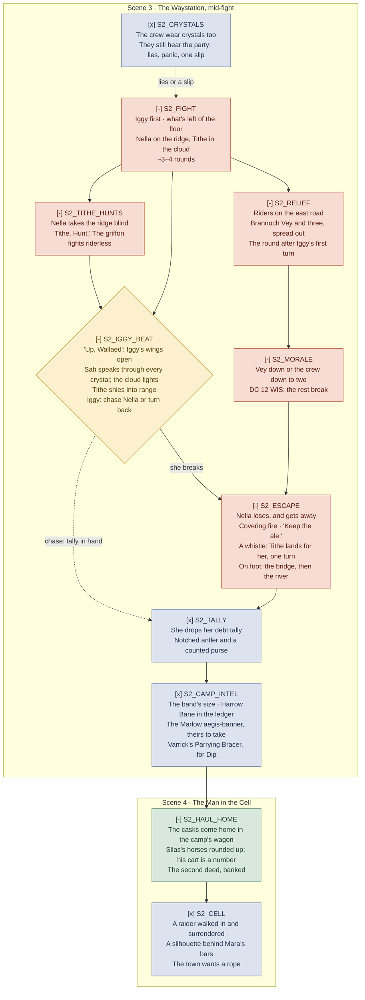

> **Carried from Session 33 and stepped up (2026-11-10).** Session 33 played the hill, the
> approach and the opening of the camp fight (`S2_TEN_MINUTES`, `S2_SPOTTER`, `S2_AMBUSH`,
> `S2_APPROACH_CHOICE`, and `S2_FIGHT` through the start of round 2); those nodes are dropped, and
> the played chart stays in `historian/sessions/Session 33 The Red Trail/_flow.md`. `S2_PARLEY` is
> gone with the approach. Jeff chose to step the rest of the fight up (option 4): Nella takes the
> ridge and sets Tithe hunting (`S2_TITHE_HUNTS`), and relief riders come up the east road
> (`S2_RELIEF`).

> **Earlier carries:** from Session 32 (2026-11-04), Session 31 (2026-10-27) and Session 30
> (2026-10-21). Their played charts stay in their historian folders.

Not an entity. A derived view of `Session 34 The Red Trail.md` in this folder, drawn for reading at
the table. The `_` prefix keeps it out of `validate.ps1`'s entity checks and the semantic index.

The pursuit half grows out of the workshop's `act-1-flow/02-session-2-pursuit.md`; this file is the
graduated copy and is now the one to edit. Ids use `S2_` (act session 2).

Legend: rust is combat · parchment is social · lantern-yellow diamond is a real fork · green is a
share tick or payoff · blue is a thread planted · dashed dusty red is a designed setback · dashed
grey is undecided. Markers: `[x]` committed, `[-]` draft, `[?]` open. Boxes are the scenes.

**Commitment:** the two new beats are drafts, and five carried beats dropped to `[-]` because the
step-up changed what's in them (2026-11-10, see the ledger). `S2_TALLY`, `S2_CAMP_INTEL` and
`S2_CELL` keep their approval but sit downstream of drafts until `/review 34 --ready`.

**Difficulty, as settled:** standard attrition, standard lethality, stepped up by Jeff. ~240 HP
standing across the floor, the ridge, the cloud and the road; RTC ~3.5 rounds counting Iggy's
opening turn (v0.56.0 rules).

## Commitment ledger

Played at Sessions 30–33 and dropped here (see each session's historian `_flow.md`). Cut:
`S2_STATEMENT` (2026-10-27), `S2_HEIST` and `S2_SKIP` (2026-11-04), `S2_PARLEY` (the approach was
played as an assault, 2026-11-10).

Dropped to `[-]` on 2026-11-10, when the step-up changed their content (Jeff approved the step-up
as option 4; the beats as written still need his look): `S2_FIGHT` (new enemies, Iggy first),
`S2_IGGY_BEAT` (Tithe makes its own save), `S2_MORALE` (trigger moved to Vey), `S2_ESCAPE`
(Nella on foot, the pickup turn), `S2_HAUL_HOME` (Silas's cart wrecked, the camp's wagon).

- `S2_CRYSTALS` — backing note at the plan, `S2_CRYSTALS`; approved 2026-11-04
- `S2_TALLY` — backing note at the plan, `S2_TALLY`; approved 2026-11-04
- `S2_CAMP_INTEL` — backing note at the plan, `S2_CAMP_INTEL`; approved 2026-11-04
- `S2_CELL` — backing note at the plan, `S2_CELL`; approved 2026-11-04
