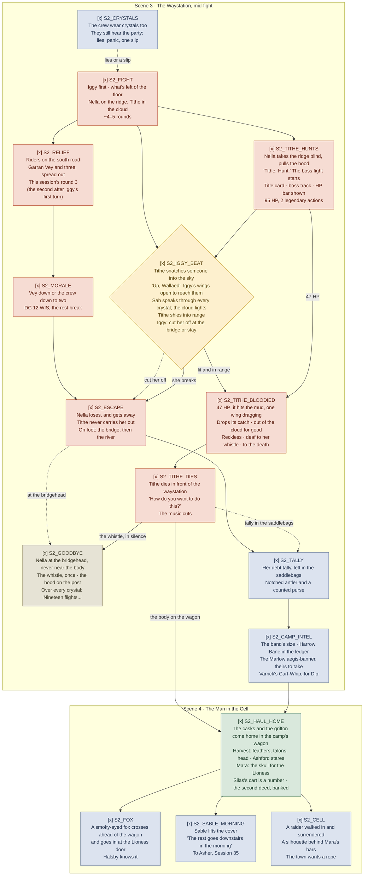

> **Carried from Session 33 and stepped up (2026-11-10).** Session 33 played the hill, the
> approach and the opening of the camp fight (`S2_TEN_MINUTES`, `S2_SPOTTER`, `S2_AMBUSH`,
> `S2_APPROACH_CHOICE`, and `S2_FIGHT` through the start of round 2); those nodes are dropped, and
> the played chart stays in `historian/sessions/Session 33 The Red Trail/_flow.md`. `S2_PARLEY` is
> gone with the approach. Jeff chose to step the rest of the fight up (option 4): Nella takes the
> ridge and sets Tithe hunting (`S2_TITHE_HUNTS`), and relief riders come up the south road
> (`S2_RELIEF`).
>
> **Refreshed 2026-11-12.** Jeff committed Tithe's death and made it the session's boss fight:
> 95 HP, legendary actions, a bloodied phase (`S2_TITHE_BLOODIED`), the kill (`S2_TITHE_DIES`),
> Nella's goodbye from the bridge (`S2_GOODBYE`), the body home on the wagon, the fox
> (`S2_FOX`) and Sable's morning hook to Asher (`S2_SABLE_MORNING`).
>
> **Earlier carries:** from Session 32 (2026-11-04), Session 31 (2026-10-27) and Session 30
> (2026-10-21). Their played charts stay in their historian folders.

Not an entity. A derived view of `Session 34 The Red Trail.md` in this folder, drawn for reading at
the table. The `_` prefix keeps it out of `validate.ps1`'s entity checks and the semantic index.

The pursuit half grows out of the workshop's `act-1-flow/02-session-2-pursuit.md`; this file is the
graduated copy and is now the one to edit. Ids use `S2_` (act session 2).

Legend: rust is combat · parchment is social · lantern-yellow diamond is a real fork · green is a
share tick or payoff · blue is a thread planted · dashed dusty red is a designed setback · dashed
grey is undecided. Markers: `[x]` committed, `[-]` draft, `[?]` open. Boxes are the scenes.

**Commitment:** every beat is committed. Jeff committed the 2026-11-12 boss changes the same day
(see the ledger).

**Difficulty, as settled:** standard attrition, standard lethality, stepped up by Jeff. ~276 HP
standing across the floor, the ridge, the cloud and the road, with Tithe as the boss; RTC ~4
rounds counting Iggy's opening turn (v0.56.0 rules). Tithe likely dies in round 4 or 5.

## Commitment ledger

Played at Sessions 30–33 and dropped here (see each session's historian `_flow.md`). Cut:
`S2_STATEMENT` (2026-10-27), `S2_HEIST` and `S2_SKIP` (2026-11-04), `S2_PARLEY` (the approach was
played as an assault, 2026-11-10).

Dropped to `[-]` on 2026-11-10, when the step-up changed their content (Jeff approved the step-up
as option 4; the beats as written still need his look): `S2_FIGHT` (new enemies, Iggy first),
`S2_IGGY_BEAT` (Tithe makes its own save), `S2_MORALE` (trigger moved to Vey), `S2_ESCAPE`
(Nella on foot, the pickup turn), `S2_HAUL_HOME` (Silas's cart wrecked, the camp's wagon).

Committed 2026-11-11 (Jeff, after `/review 34` and the snatch trigger): `S2_FIGHT`,
`S2_RELIEF`, `S2_IGGY_BEAT`, `S2_MORALE`. Backing notes are the plan's nodes of the same names.

Dropped to `[-]` on 2026-11-12, when the boss fight and Tithe's death changed their content (Jeff
approved the changes; the beats as written still need his look): `S2_TITHE_HUNTS` (the boss
intro), `S2_ESCAPE` (Tithe never carries her out), `S2_HAUL_HOME` (the body, the skull, the
harvest). Recommitted the same day.

Committed 2026-11-12 (Jeff, after the boss refresh): `S2_TITHE_HUNTS`, `S2_TITHE_BLOODIED`,
`S2_TITHE_DIES`, `S2_GOODBYE`, `S2_ESCAPE`, `S2_HAUL_HOME`, `S2_FOX`, `S2_SABLE_MORNING`. Backing
notes are the plan's sections: Tithe's block (boss, bloodied, the kill), `S2_TITHE_HUNTS`,
`S2_ESCAPE` (the goodbye), and `S2_HAUL_HOME` (the fox, Sable sees the griffon).

Edited 2026-11-12 at `/review` (Jeff approved all findings), kept `[x]`: `S2_IGGY_BEAT` (Iggy's
choice is now cut Nella off at the bridge or stay over the yard), `S2_TALLY` (left in Tithe's
saddlebags), `S2_FIGHT` (~4–5 rounds), `S2_RELIEF` (moved back to this session's third round,
Jeff's pick).

Moved 2026-11-12, wording unchanged, kept `[x]`: `S2_TITHE_BLOODIED`, `S2_TITHE_DIES` and
`S2_GOODBYE` now have their own plan sections, so the session runner can show them as steps and
mark the boss fight. The bloodied and kill read-alouds came out of Tithe's block (its rules
stay there), and the goodbye came out of `S2_ESCAPE`. Added cues: `When:` lines on all three,
`Boss fight starts:` on `S2_TITHE_HUNTS` and `Boss fight ends:` on `S2_TITHE_DIES`.

- `S2_CRYSTALS` — backing note at the plan, `S2_CRYSTALS`; approved 2026-11-04
- `S2_TALLY` — backing note at the plan, `S2_TALLY`; approved 2026-11-04
- `S2_CAMP_INTEL` — backing note at the plan, `S2_CAMP_INTEL`; approved 2026-11-04
- `S2_CELL` — backing note at the plan, `S2_CELL`; approved 2026-11-04
