# Session 35 — The Reeve's Ledger · flow

> **Carried from [[Session 34 The Red Trail]] at its `/recap` (2026-11-18).** Its unplayed beats
> come here with new `S35_` ids, matched by slug, and keep their markers. `S2_MORALE` is dropped.
>
> **Reshaped by Jeff's review (2026-11-22):** a recap for every PC and for Nella, the chase as one
> roll on the south riverbank, the banner out, the items made in Asher's cave.
>
> **Season finale, with Tyler's entrance last (Jeff, 2026-11-23).** The reeve moved from Day 3 to
> the morning of Day 18. Mara's rider sets the day in Scene 8, a gallows goes up during the build,
> Dip leaves at dawn, then the reeve sets the hanging for noon and Shaw speaks. The ledger choice
> moved with the reeve: `S35_26_REEVE` is now `S35_29_REEVE`.
>
> **Last session before the DM rotation.** Ben DMs next; Dip goes `state: away` after it.

Not an entity. This is a derived view of the plan, for reading at the table. The plan file wins
where they differ; regenerate with `/flow --session 35` rather than hand-editing both.

Legend: rust is combat · parchment is social · lantern-yellow diamond is a real fork · green is a
share tick or payoff · blue is a thread planted · dashed dusty red is a designed setback · dashed
grey is undecided. Markers: `[x]` committed, `[-]` draft, `[?]` open. Boxes are the scenes.

**Commitment:** the carried Session 34 beats stay `[x]`. Everything new is `[-]` draft.

**Difficulty, as settled:** standard attrition, standard lethality. No fight on the grid: Nella's
escape is one check (DC 18). Everything else is social.

```mermaid
flowchart TD
  subgraph SC1["Scene 1 · Up, Wallaed"]
    S35_01_IGGY_BEAT["[x] S35_01_IGGY_BEAT<br/>Recap: the wings, the smite,<br/>'Up, Wallaed' in every crystal"]
    S35_02_COLD["[-] S35_02_COLD<br/>Recap: Odibli's fight<br/>and the Citadel's cold"]
    S35_03_RECAPS["[-] S35_03_RECAPS<br/>Recap: Dip, Luci, Halsby<br/>one fight, three sides"]
    S35_04_NELLA_TITHE["[-] S35_04_NELLA_TITHE<br/>The whistle<br/>Tithe lays its head down"]
  end

  subgraph SC2["Scene 2 · The River"]
    S35_05_ODIBLI_DOWN{"[-] S35_05_ODIBLI_DOWN<br/>Odibli under Tithe<br/>Iggy: land and heal, or fly?"}
    S35_06_GOODBYE["[x] S35_06_GOODBYE<br/>The hood on the willow<br/>'Nineteen flights'"]
    S35_07_CHASE{"[-] S35_07_CHASE<br/>Spike Growth, one roll, DC 18<br/>caught or gone?"}
    S35_08_ESCAPE["[x] S35_08_ESCAPE<br/>The staked line and the river<br/>the rigging shown after"]
  end

  subgraph SC3["Scene 3 · The Yard After"]
    S35_09_TALLY["[x] S35_09_TALLY<br/>Antler tally, 250 gp purse<br/>exactly her debt"]
    S35_10_CAMP_INTEL["[x] S35_10_CAMP_INTEL<br/>Thirty bedrolls<br/>Bane's ledger in a tin"]
    S35_11_BODIES["[-] S35_11_BODIES<br/>What the fire left<br/>Vey's order, five crystals"]
  end

  subgraph SC4["Scene 4 · The Road Home"]
    S35_12_HAUL_HOME["[x] S35_12_HAUL_HOME<br/>Wagon, griffon, Silas's horses<br/>'That's twice now'"]
    S35_13_FOX["[x] S35_13_FOX<br/>A fox goes in<br/>at the Lioness door"]
    S35_14_SABLE_MORNING["[x] S35_14_SABLE_MORNING<br/>'In the morning it goes<br/>to the river'"]
    S35_15_CELL["[x] S35_15_CELL<br/>The square talks<br/>six cells, one silent man"]
  end

  subgraph SC5["Scene 5 · Asher"]
    S35_16_THE_SPRING["[-] S35_16_THE_SPRING<br/>The cave of fireflies<br/>Asher rises, gives his name"]
    S35_17_TRUE_STORY["[-] S35_17_TRUE_STORY<br/>Dip tells a true story<br/>over the water"]
    S35_18_THE_ASK{"[-] S35_18_THE_ASK<br/>Tithe drawn through the earth<br/>Dip: take the debt? The sister"}
    S35_19_ASHER_BOW["[-] S35_19_ASHER_BOW<br/>Iggy's questions, Halsby square<br/>Oathcaller, Tithe-Taker made"]
    S35_20_LUCI_DRAUGHT{"[-] S35_20_LUCI_DRAUGHT<br/>Asher's draught<br/>Luci: now, later, never?"}
  end

  subgraph SC6["Scene 6 · Stand Still"]
    S35_21_TRIP["[-] S35_21_TRIP<br/>The temple through the town<br/>'Stand still, and I can reach you'"]
    S35_22_WRAPS["[-] S35_22_WRAPS<br/>She wakes in the ford<br/>the Stillwater Wraps"]
  end

  subgraph SC7["Scene 7 · Count Them"]
    S35_23_ELOWEN["[-] S35_23_ELOWEN<br/>'There's two of you'<br/>the company she moved, the flock"]
    S35_24_BINDING["[-] S35_24_BINDING<br/>She buckles the brace on him<br/>the Unfinished Binding"]
  end

  subgraph SC8["Scene 8 · The Deed"]
    S35_25_STAKE["[-] S35_25_STAKE<br/>The deed argued<br/>twenty, or twenty-five"]
    S35_26_RIDER["[-] S35_26_RIDER<br/>Mara's rider is back<br/>the reeve comes on the eighteenth"]
  end

  subgraph SC9["Scene 9 · Opening Night"]
    S35_27_BUILD["[-] S35_27_BUILD<br/>Two weeks building, a gallows in the square<br/>'What did you do?' · Halsby: the job, or a question?"]
    S35_28_DIP_ROAD["[-] S35_28_DIP_ROAD<br/>Dip takes the road at dawn<br/>past the scaffold, Ben leads"]
  end

  subgraph SC10["Scene 10 · The Reeve's Ledger"]
    S35_29_REEVE{"[-] S35_29_REEVE<br/>Cael's reeve wants the ledger<br/>hand it over or keep it? 'Then noon.'<br/>the rope goes up"}
    S35_30_SPEAKS["[-] S35_30_SPEAKS<br/>'What do you know about it?'<br/>an opening each, one true thing<br/>Shaw holds out the letter"]
  end

  NELLA_AWAY["[-] Nella away downstream"]
  NELLA_CAUGHT["[-] Nella caught<br/>'Well. That'll cost me.'"]
  ODIBLI_DEAD["[-] Odibli fails three saves"]
  LEDGER_CAEL["[-] Cael holds Bane's name"]
  LEDGER_KEPT["[-] Party holds the only proof"]

  S35_01_IGGY_BEAT --> S35_02_COLD --> S35_03_RECAPS --> S35_04_NELLA_TITHE --> S35_05_ODIBLI_DOWN
  S35_05_ODIBLI_DOWN -->|"land and heal"| S35_06_GOODBYE
  S35_05_ODIBLI_DOWN -->|"fly: advantage on the roll"| S35_06_GOODBYE
  S35_05_ODIBLI_DOWN -.->|"nobody reaches him"| ODIBLI_DEAD
  S35_06_GOODBYE --> S35_07_CHASE
  S35_07_CHASE -->|"success"| NELLA_CAUGHT
  S35_07_CHASE -->|"fail, or let go"| S35_08_ESCAPE --> NELLA_AWAY
  NELLA_AWAY --> S35_09_TALLY
  NELLA_CAUGHT --> S35_09_TALLY
  S35_09_TALLY --> S35_10_CAMP_INTEL --> S35_11_BODIES --> S35_12_HAUL_HOME
  S35_12_HAUL_HOME --> S35_13_FOX --> S35_14_SABLE_MORNING --> S35_15_CELL
  S35_15_CELL -->|"long rest"| S35_16_THE_SPRING
  S35_16_THE_SPRING --> S35_17_TRUE_STORY --> S35_18_THE_ASK --> S35_19_ASHER_BOW --> S35_20_LUCI_DRAUGHT
  S35_20_LUCI_DRAUGHT -->|"drinks"| S35_21_TRIP --> S35_22_WRAPS --> S35_23_ELOWEN
  S35_20_LUCI_DRAUGHT -->|"later or never"| S35_23_ELOWEN
  S35_23_ELOWEN --> S35_24_BINDING --> S35_25_STAKE --> S35_26_RIDER
  S35_26_RIDER --> S35_27_BUILD --> S35_28_DIP_ROAD --> S35_29_REEVE
  S35_29_REEVE -->|"hand it over"| LEDGER_CAEL
  S35_29_REEVE -->|"keep it"| LEDGER_KEPT
  LEDGER_CAEL --> S35_30_SPEAKS
  LEDGER_KEPT --> S35_30_SPEAKS

  S35_18_THE_ASK -.->|"the field waits for Dip"| S35_28_DIP_ROAD
  S35_10_CAMP_INTEL -.->|"the ledger"| S35_29_REEVE
  S35_15_CELL -.->|"the silent man"| S35_26_RIDER
  S35_15_CELL -.->|"the hanging waits"| S35_30_SPEAKS
  S35_19_ASHER_BOW -.->|"who studies his kind"| S35_27_BUILD
  S35_27_BUILD -.->|"the new rope"| S35_29_REEVE

  classDef combat   fill:#FDE2E2,stroke:#DC2626,color:#5B1414
  classDef social   fill:#D7F0EE,stroke:#2B8F89,color:#123F3C
  classDef decision fill:#FBF0CF,stroke:#C79A2B,color:#5A4410
  classDef stake    fill:#D8F5E2,stroke:#22A35A,color:#134D2A
  classDef seed     fill:#DCE8FA,stroke:#3987E5,color:#17345E
  classDef fail     fill:#F8DDE7,stroke:#D55181,color:#5A1A32,stroke-dasharray:4 3
  classDef open     fill:#ECEFF3,stroke:#94A3B8,color:#334155,stroke-dasharray:4 3

  class S35_08_ESCAPE,NELLA_CAUGHT combat
  class S35_02_COLD,S35_03_RECAPS,S35_04_NELLA_TITHE,S35_06_GOODBYE,S35_11_BODIES,S35_12_HAUL_HOME,S35_14_SABLE_MORNING,S35_16_THE_SPRING,S35_17_TRUE_STORY,S35_26_RIDER,S35_28_DIP_ROAD,S35_30_SPEAKS social
  class S35_05_ODIBLI_DOWN,S35_07_CHASE,S35_18_THE_ASK,S35_20_LUCI_DRAUGHT,S35_29_REEVE decision
  class S35_09_TALLY,S35_19_ASHER_BOW,S35_22_WRAPS,S35_24_BINDING,S35_25_STAKE,LEDGER_CAEL,LEDGER_KEPT,S35_27_BUILD stake
  class S35_01_IGGY_BEAT,S35_10_CAMP_INTEL,S35_13_FOX,S35_15_CELL,S35_21_TRIP,S35_23_ELOWEN seed
  class NELLA_AWAY,ODIBLI_DEAD fail
```

## Commitment ledger

- **Carried from Session 34 by slug, kept `[x]`:** `S35_06_GOODBYE` (was `S2_GOODBYE`; the
  whistle moved to `S35_04_NELLA_TITHE`, the place moved to the south riverbank), `S35_09_TALLY`
  (`S2_TALLY`), `S35_15_CELL` (`S2_CELL`; the square and six cells added).
- **Carried and split, kept `[x]`:** `S2_HAUL_HOME` is now three beats, `S35_12_HAUL_HOME` (plus
  Silas waiving Halsby's shoeing), `S35_13_FOX` and `S35_14_SABLE_MORNING`. The lines are
  Session 34's.
- **Carried and trimmed to what's still live, kept `[x]`:** `S35_01_IGGY_BEAT` (`S2_IGGY_BEAT`,
  now the opening recap; the shy save, the morale effect and the old choice are gone),
  `S35_08_ESCAPE` (`S2_ESCAPE`, the river and the staked line only; no bridge),
  `S35_10_CAMP_INTEL` (`S2_CAMP_INTEL`, adjusted for the fire; the banner removed, Jeff's review
  2026-11-22).
- **Rewritten, now `[-]`:** `S35_11_BODIES` (`S2_BODIES`): most of the dead burned.
- **Dropped:** `S2_MORALE`. The crew is dead; there's nobody left to break.
- **New, `[-]`:** the recaps (Odibli and the cold, Dip, Luci, Halsby, Nella and Tithe), Odibli
  under Tithe, the one-roll chase, the whole cave scene with the items made there, the trip and
  the Wraps, Elowen's flashback and the Binding, the stake, Mara's rider, the two weeks of
  building with the gallows, opening night, Dip's road (Ben leads it), the reeve, and Shaw's
  first words and the letter (Tyler's entrance, the season's last beat).
- **Renumbered, still `[-]`:** `S35_26_REEVE` is now `S35_29_REEVE`, moved from Day 3 dusk to
  Day 18 mid-morning (Jeff, 2026-11-23). `S35_26` is reused for Mara's rider.

- **Added in review, `[-]` (draft, engine 2026-11-23):** Halsby's choice on Sable's job
  (`S35_27_BUILD`), the rope hung after "noon" (`S35_29_REEVE`), one opening per PC and the one
  true thing Shaw tells (`S35_30_SPEAKS`).

Elowen's scene moved here from Session 36 (todo 100): Session 36 is Ben's.
