# Session 36 — The Long Way North · flow

> **Ben's first session as DM** (planned 2026-11-25). Picks up from [[Session 35 The Reeve's Ledger]]'s cliffhanger in Mara's office.

Not an entity. This is a derived view of the plan, for reading at the table. The plan file wins where they differ; regenerate with `/flow --session 36` rather than hand-editing both.

Legend: rust is combat · parchment is social · lantern-yellow diamond is a real fork · green is a payoff · blue is a thread planted · dashed grey is undecided. Markers: `[x]` committed, `[-]` draft, `[?]` open. Boxes are the scenes.

**Commitment:** nothing committed yet. Every beat is `[-]` draft, and the Kerning's size is `[?]` until the DM decides at the table.

**Difficulty, as settled:** light attrition, standard lethality. One fight, Haftimin, fixed at 4 rounds.

```mermaid
flowchart TD
  subgraph SC1["Scene 1 · Mara's office"]
    S36_01_RECAP["[-] S36_01_RECAP<br/>Previously on, and<br/>Shaw holds out the letter"]
    S36_02_LETTER["[-] S36_02_LETTER<br/>Choco La's letter<br/>read aloud"]
    S36_03_TONIGHT{"[-] S36_03_TONIGHT<br/>Go north tonight,<br/>or sleep first?"}
  end

  subgraph SC2["Scene 2 · Leaving Ashford"]
    S36_04_HORSES["[-] S36_04_HORSES<br/>Five horses can't go to sea<br/>Old Tom refuses to stay"]
    S36_05_HORSE_CHOICE{"[-] S36_05_HORSE_CHOICE<br/>Leave with Mara, sell,<br/>or pay the freight?"}
    S36_06_MARA["[-] S36_06_MARA<br/>Mara's goodbye<br/>thanks Iggy for asking"]
    S36_07A_NIGHT_BOAT["[-] S36_07A_NIGHT_BOAT<br/>Gone by dusk<br/>the reeve is just a name"]
    S36_07B_RIDER["[-] S36_07B_RIDER<br/>Cael's rider at the dock<br/>Persuasion 13 / 16"]
  end

  subgraph SC3["Scene 3 · Downriver"]
    S36_08_RIVER["[-] S36_08_RIVER<br/>Two days downriver<br/>a hood on a passing barge"]
  end

  subgraph SC4["Scene 4 · Captain Mallow's ship"]
    S36_09_MALLOW["[-] S36_09_MALLOW<br/>'Your brother<br/>paid for two'"]
    S36_10_SHANTY["[-] S36_10_SHANTY<br/>The River Daughter<br/>verses swapped"]
    S36_11_BOSCO["[-] S36_11_BOSCO<br/>Bosco and Hax<br/>go to war"]
    S36_12_BEAMS["[-] S36_12_BEAMS<br/>Bright nights<br/>'the Beams are groaning'"]
  end

  subgraph SC5["Scene 5 · The thing under the ice"]
    S36_13_LIGHTS["[-] S36_13_LIGHTS<br/>Lights under<br/>the sea ice"]
    S36_14_TENTACLES["[-] S36_14_TENTACLES<br/>Haftimin rises<br/>six arms at a time"]
    S36_15_DRAGGED{"[-] S36_15_DRAGGED<br/>Pell at the rail<br/>Iggy: step in front?"}
    S36_16_BEAM_CRACK["[-] S36_16_BEAM_CRACK<br/>A Beam cracks in the north<br/>Haftimin lets go"]
  end

  subgraph SC6["Scene 6 · Cinto at the Kerning"]
    S36_17_HARBOUR["[-] S36_17_HARBOUR<br/>Cinto out<br/>of the fog"]
    S36_18_KERNING{"[?] S36_18_KERNING<br/>The whistle<br/>minor or major landing?"}
  end

  subgraph SC7["Scene 7 · The Last Fire"]
    S36_19_CAL["[-] S36_19_CAL<br/>'Choco La's Shaw!'<br/>the tab and the stool"]
    S36_20_WORD["[-] S36_20_WORD<br/>Word got<br/>here first"]
    S36_21_CATECHISM["[-] S36_21_CATECHISM<br/>Iggy plays<br/>the blank prayer book"]
    S36_22_WORRY{"[-] S36_22_WORRY<br/>Whose worry first?"}
    S36_23_PILLOW["[-] S36_23_PILLOW<br/>RETURN TO SENDER<br/>on Shaw's pillow"]
  end

  S36_01_RECAP --> S36_02_LETTER --> S36_03_TONIGHT
  S36_03_TONIGHT --> S36_04_HORSES --> S36_05_HORSE_CHOICE --> S36_06_MARA
  S36_06_MARA -->|tonight| S36_07A_NIGHT_BOAT
  S36_06_MARA -->|morning| S36_07B_RIDER
  S36_07A_NIGHT_BOAT --> S36_08_RIVER
  S36_07B_RIDER --> S36_08_RIVER
  S36_08_RIVER --> S36_09_MALLOW --> S36_10_SHANTY --> S36_11_BOSCO --> S36_12_BEAMS
  S36_12_BEAMS --> S36_13_LIGHTS --> S36_14_TENTACLES --> S36_15_DRAGGED --> S36_16_BEAM_CRACK
  S36_16_BEAM_CRACK --> S36_17_HARBOUR --> S36_18_KERNING
  S36_18_KERNING --> S36_19_CAL --> S36_20_WORD --> S36_21_CATECHISM --> S36_22_WORRY --> S36_23_PILLOW

  classDef combat fill:#c9826b,stroke:#5a2a1a,color:#000
  classDef social fill:#efe3c8,stroke:#7a6a4a,color:#000
  classDef decision fill:#f3d36b,stroke:#7a5a10,color:#000
  classDef seed fill:#bcd4ea,stroke:#2a4a6a,color:#000
  classDef open fill:#eeeeee,stroke:#888,color:#000,stroke-dasharray: 5 4
  class S36_14_TENTACLES combat
  class S36_01_RECAP,S36_04_HORSES,S36_06_MARA,S36_07B_RIDER,S36_09_MALLOW,S36_11_BOSCO,S36_17_HARBOUR,S36_19_CAL,S36_20_WORD social
  class S36_03_TONIGHT,S36_05_HORSE_CHOICE,S36_15_DRAGGED,S36_22_WORRY decision
  class S36_02_LETTER,S36_08_RIVER,S36_10_SHANTY,S36_12_BEAMS,S36_13_LIGHTS,S36_21_CATECHISM,S36_23_PILLOW,S36_07A_NIGHT_BOAT,S36_16_BEAM_CRACK seed
  class S36_18_KERNING open
```

## Commitment ledger

Nothing committed yet.
